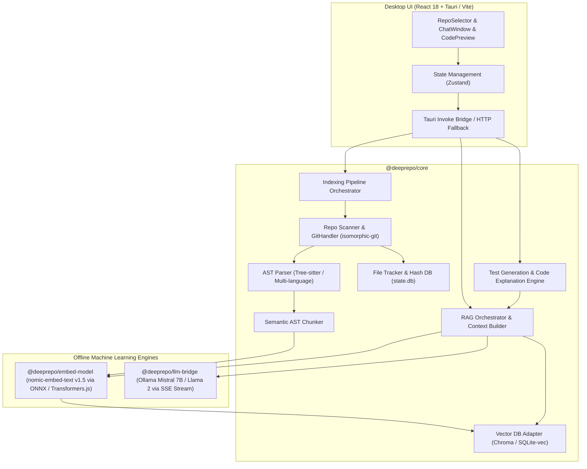

# Architecture Overview – DeepRepo (The Dark Side)

DeepRepo is a desktop-native, privacy-first Retrieval-Augmented Generation (RAG) and semantic exploration platform for local Git repositories.

## Architectural Design Principles

1. **Zero External Data Exfiltration**:
   Every layer executes locally. Embeddings are calculated on the CPU/GPU via ONNX runtime (`@xenova/transformers` with `nomic-embed-text-v1.5`), and inference connects strictly to local Ollama endpoints (`http://localhost:11434`).

2. **AST-Aware Chunking vs. Naive Splitting**:
   Code is parsed through AST structures to identify functional entities (functions, methods, classes, interfaces). Chunks retain docstrings, type signatures, and parent scope metadata rather than arbitrary line slices.

3. **Incremental Indexing via Content Hash Tracking**:
   Files are hashed (SHA-256) upon scanning. Only modified or added files undergo AST parsing and vectorization. Deleted files automatically trigger vector purge operations in Chroma.

4. **Token-Budgeted Context Assembly**:
   With local models having typical 8k context limits, DeepRepo dynamically allocates context budgets:
   - System instructions & prompt templates: ~500 tokens
   - Top-5 semantic chunks + surrounding line metadata: ~2000 tokens
   - Multi-turn conversation buffer (last 5 interactions): ~1000 tokens
   - Generation headroom: ~4000+ tokens

5. **Desktop Portability**:
   Tauri provides lightweight native shell performance with Rust bindings, cross-compilable for Windows, macOS, and Linux. Pure JavaScript Git operations via `isomorphic-git` eliminate external Git binary dependencies.
